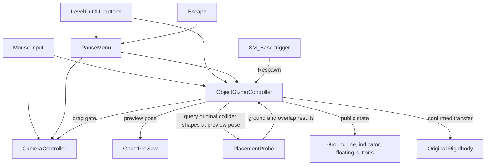

# Oops, Nice Shot! Project Documentation

Project reference for the saved working copy, reviewed 28 November 2026.

## Contents

- [Project overview](#project-overview)
- [Implementation status](#implementation-status)
- [Project structure](#project-structure)
- [Architecture](#architecture)
- [Gameplay implementation](#gameplay-implementation)
- [C# reference](#c-reference)
- [Shader reference](#shader-reference)
- [Unity asset relationships](#unity-asset-relationships)
- [Implementation constraints](#implementation-constraints)
- [Maintenance findings](#maintenance-findings)
- [Unity tooling and verified baseline](#unity-tooling-and-verified-baseline)

## Project overview

**Design intent.** The player is the god of minigolf, helping an exceptionally bad golfer by changing the course. The overhead view should show the ball, hole, interactive objects and an initial predicted shot path. The player examines the prediction, uses one environmental action, lets the golfer hit, and observes where physics takes the ball. The loop repeats until the hole is reached or the limited shots run out. Fewer actions improve the score. A puzzle might use a ramp to reach an elevated surface, then a fan to redirect the next shot. Springs, wind and rain are intended tools. Progression should introduce tools and harder courses while leaving room for experimentation and multiple solutions.

**Saved prototype.** Main Menu opens the Level Selector, which loads the island scene. The current loop is to navigate the camera, select a physics cube, reposition or rotate its ghost, confirm or cancel, and watch the placed cube return to physics. The same interaction can be repeated freely. The ground line marks the ghost's position relative to a surface. Golf shots and outcomes are planned.

**Technology.** [ProjectVersion.txt](ProjectSettings/ProjectVersion.txt) specifies Unity **6000.4.9f1** (`f7258d6eebbe`). The project uses C#, Unity 3D physics, the new Input System 1.19.0, URP and Shader Graph packages at 17.4.0, uGUI 2.0.0 with TextMesh Pro resources, and hand-written ShaderLab/HLSL. The [manifest](Packages/manifest.json) and [lockfile](Packages/packages-lock.json) also declare Test Framework 1.6.0, Timeline, AI Navigation, Visual Scripting, Multiplayer Center, IDE integrations, and Unity modules. Those declarations alone establish availability as dependencies. The working copy additionally declares the Coplay Unity MCP Git package; its lock entry records a resolved revision. Live availability is described below.

## Implementation status

| Status | Feature | Evidence |
| --- | --- | --- |
| Implemented | Camera pan, orbit, cursor-centered zoom, bounds and projection modes | `CameraController` on `Level1` Main Camera. Perspective is the saved starting mode. |
| Implemented | Physics-object selection, move/rotate ghost, world/local axes, validation, confirm/cancel and transfer | `ObjectGizmoController` and its partials, `PlacementProbe`, wired buttons and three dynamic cubes. |
| Implemented | Placement visuals and object recovery path | Ghost and outline, vertical ground line, ground indicator, and `SM_Base` trigger wired to restore registered spawn poses. It uses the registered spawn pose. |
| Implemented | Main menu entry, pause/resume and return from Level1 | Scene button callbacks and `PauseMenu` references. |
| Implemented | Island rendering and procedural water | `PC_RPAsset`, `PC_Renderer`, FBX model instances, and `SM_Water` assigned the custom water material. |
| Partial | Level selection | Buttons for Levels 1–3 all load the one saved playable scene. Back targets MainMenu in the saved working copy. There is no unlocking or progression state. |
| Experimental | Pixelation and tilt shift | Camera material drivers are enabled on the saved camera. Their full-screen renderer features are inactive in the PC renderer asset. |
| Planned | Ball, golfer, club/shot execution, pre-shot trajectory, hole detection, win/fail flow | No corresponding custom runtime code or project scene setup found. The moving Rigidbody examples are cubes. |
| Planned | Course tools, weather, one action per shot, shot budget, scoring and progression | Generic pose placement exists. No ramp, fan, spring, wind/rain gameplay, turn authority, counting, score or progression system found. The water shader changes the surface appearance. |

## Project structure

| Location | Responsibility |
| --- | --- |
| [Assets/MiniGolf/Scenes](Assets/MiniGolf/Scenes) | `MainMenu.unity`, `LevelSelector.unity` and `Level1.unity`, in build order. |
| [Assets/MiniGolf/Scripts](Assets/MiniGolf/Scripts) | Camera, placement and recovery, rendering drivers, and UI each have a folder. The placement controller and its partials live together. The shared runtime `MiniGolfFoldoutAttribute` sits at the root, and its Inspector implementation lives in `Editor/`. |
| [Assets/MiniGolf/Art](Assets/MiniGolf/Art) | `Models/` contains the FBX files. `Materials/` and `Textures/` group environment assets by subject, with separate Island and Tree folders. |
| [Assets/MiniGolf/Rendering](Assets/MiniGolf/Rendering) | `Placement/` contains the gizmo and placement feedback shaders and their `Materials/`. `PostProcessing/` contains the pixelation and tilt-shift shaders and materials. `Water/` contains the active water shader and material. |
| [Assets/MiniGolf/Settings](Assets/MiniGolf/Settings) | The project-wide input actions sit at the root. `Rendering/` contains the PC pipeline, renderer, URP global settings, and volume profiles. |
| [Packages](Packages) and [ProjectSettings](ProjectSettings) | Package declarations, editor/build list, player, input, physics, quality, and graphics settings. |
| `Assets/TextMesh Pro/` | Imported TMP fonts, resources, shaders, and vendor examples in their original layout. |

## Architecture

The project currently uses scene-owned components, serialized Inspector wiring, and direct calls. uGUI Button persistent events invoke controller methods. Ground feedback and floating UI read the gizmo's public properties each frame. There is no custom event bus, persistent session manager, or separate gameplay state asset. Direct Input System device reads drive world interactions.

| When | Ownership and dependencies |
| --- | --- |
| `Awake` | Camera applies the initial pose and projection. Gizmo validates shaders and camera, allocates render resources and initializes handles. Line and indicator prepare runtime renderers. Pause hides its panel. Floating UI caches its parent canvas. |
| `Start` | Gizmo scans current Rigidbodies through `RegisterSpawn`. It stores the first pose for each eligible dynamic body. |
| `Update` | Camera handles pan/orbit/zoom, pause handles Escape, and gizmo ticks existing transfers, reads pointer/UI state, and starts or updates a drag. Gizmo has `DefaultExecutionOrder(100)`. |
| `LateUpdate` | Camera applies unscaled smoothing. Gizmo updates preview lift or drag, syncs transforms, measures graphics bounds, evaluates ground and overlap, processes queued confirm, and draws. Ground line and floating UI at order 101 and indicator at 102 can read the updated state. |
| Physics and teardown | Physics simulates on fixed steps. Trigger entry delegates recovery to the gizmo. Selection owns temporary ghost visuals and a saved Rigidbody state, then hands them to the transfer list on confirm. While active and unpaused, losing the preview or selected body clears the selection and restores a surviving body. Disable clears selection and finishes or rolls back pending transfers. Destroy releases generated visual resources. |

`ObjectGizmoController` owns the single active selection and the list of transfers. The two partial files split rendering/drag math and transfer/recovery within the same component. Its public read model is `ViewCamera`, `SelectedObject`, `PreviewTransform`, `PreviewValid`, `HasGround`, `GroundHit`, `GroundStart`, `PreviewBounds`, `PreviewColor`, `IsOverForbiddenSurface`, `IsRotationTool`, and `IsLocalSpace`. `PreviewValid` reports obstacle clearance. Confirmation requires both `PreviewValid` and `HasGround`.

## Gameplay implementation

1. **Look around.** Middle-drag pans along the plane at the camera pivot's Y. Right-drag changes yaw and pitch. The scroll wheel adjusts FOV or orthographic size and offsets focus to keep the pointed ground location steady where possible. The camera uses a convex bounds collider and damped overshoot. Gestures start outside UI. Pause and gizmo drag have separate camera input gates.
2. **Pick an object.** A left-click outside UI first checks handles on the current preview, then casts through the selection mask. `Select` accepts an eligible non-kinematic Rigidbody, saves gravity, CCD and interpolation, zeros velocities, and makes the original kinematic at its existing pose. A visual ghost starts at the same pose and lifts. Clicking empty space keeps the current selection. Selecting another eligible body replaces it.
3. **Manipulate the preview.** Move mode supports three axes and three planes. Rotate mode supports three arcs. World space uses global axes and Local uses the preview orientation. Drag start captures its frame so the axes remain stable while moving or rotating. Releasing the mouse ends the drag. The preview can be edited repeatedly before placement.
4. **Check the pose.** `PlacementProbe.Measure` combines ghost mesh renderer bounds and subtracts the visual child's world-space shake offset. `FindGround` casts downward at the unshaken bounds center, considers allowed and forbidden masks, excludes hits on the original, and selects the nearest qualifying hit near or below the bottom. Allowed hits must be non-trigger and have an upward-facing normal. Forbidden hits may be triggers and take precedence on a tie. `CanPlace` checks eligible source colliders at the proposed pose using a sphere broad phase and `Physics.ComputePenetration`. The line and marker follow the ground hit while the outline, ghost color and Place tint report the current state.
5. **Place or cancel.** Place calls `RequestPlacement`, which queues `Confirm` after the next eligible validation in `LateUpdate`. A rejected confirmation shakes the ghost. Cancel restores the body to dynamic behavior at its original location with zero velocity. A valid confirmation starts a smooth transfer of the original to the exact preview pose with collision detection disabled in transit. At arrival, the destination is checked for overlaps and blocked transfers roll back. After arrival and a short hold, physics resumes and the object can fall onto the surface. Placement can therefore be valid at a height above the hit, and the controller allows multiple transfers to overlap in time.
6. **Recover or pause.** `ObjectRespawnTrigger.OnTriggerEnter` requests recovery to the registered pose, clearing that body's selection or transfer first. Pause via Escape or the Pause button ends the active drag, drops a queued confirm, stops a pending pickup lift, and sets `Time.timeScale` to zero. Continue restores the previous scale and clears the input gates. Returning to the main menu uses the normal single-scene loading path.

There is no custom ball, golfer, trajectory simulation, shot clock, or score update in this loop.

## C# reference

This inventory covers all 17 custom C# files. Numbers below are saved Level1 values where a component is wired. Identifiers in a group share the indicated role.

### Camera and object manipulation

- [CameraController.cs](Assets/MiniGolf/Scripts/Camera/CameraController.cs) — `CameraController` requires `Camera`. `Awake` initializes `groundY`, focus, yaw/pitch and projection-independent `viewHalfHeight`. `Update` handles `Mouse.current` and UI gating. `LateUpdate` smooths focus, rotation and zoom using unscaled time and applies the pose. `TryGroundPoint` casts from a hypothetical target pose for cursor anchoring. `ClampToBounds`, `LimitOvershoot`, and `RubberBand` constrain focus using `Collider.ClosestPoint`; disabled bounds are ignored and non-convex mesh or terrain bounds are unsupported. `OnValidate` clamps framing limits. `InputEnabled`, `SetPauseInputBlocked`, and `SetDragInputBlocked` are the integration points for other input owners.

  | Inspector group | Saved fields |
  | --- | --- |
  | References | `islandCenter` → Camera Pivot, `movementBounds` → Camera Bounds CapsuleCollider. |
  | Projection/framing | `projectionMode` Perspective, `cameraDistance` 250, `initialYaw` 0, `initialPitch` 20°. |
  | Pan/orbit | `panSensitivity` 1, `panSmoothTime` 0.08 s, `rotationSensitivity` 0.25°/px, `rotationSmoothTime` 0.06 s, `minPitch` 20°, `maxPitch` 50°. |
  | Bounds | `maxOvershoot` 0.1 of view height, `boundsReturnSmoothTime` 0.18 s. |
  | Zoom | `initialFieldOfView/minFieldOfView/maxFieldOfView` 7°/3°/10°, `initialOrthographicSize/minOrthographicSize/maxOrthographicSize` 17.5/6.5/40, `zoomSensitivity` 10, `zoomSmoothTime` 0.2 s, `scrollUnitsPerNotch` 120. |

- [ObjectGizmoController.cs](Assets/MiniGolf/Scripts/Placement/ObjectGizmoController.cs) — Main scene component on Main Camera. `Reset` suggests the main camera and looks up `MiniGolf/GizmoAlwaysOnTopSoft`. `Awake` requires the referenced gizmo and ghost shaders and a camera. `Start` registers eligible bodies. `Update` handles selection and drag input, and advances transfers. `LateUpdate` applies lift/drag, probes, handles confirmation, and renders. `Select` records original body flags and prepares outlines, caching welded meshes by source mesh and maintaining temporary outlines for baked skinned meshes. `ClearSelection`, `OnDisable`, `OnApplicationFocus`, and `OnDestroy` handle cleanup and restoration. The normal focus-loss path clears selection while unpaused. Public tool methods are `UseMoveTool`, `UseRotateTool`, `ToggleAxisSpace`, `RequestPlacement`, and `CancelPlacement`.
- [ObjectGizmoController.Handles.cs](Assets/MiniGolf/Scripts/Placement/ObjectGizmoController.Handles.cs) — Same component and Inspector. Handle indices 0–2 are axis arrows, 3–5 rotation arcs, and 6–8 plane tiles. `RefreshGizmoMeshes` rebuilds meshes when geometry parameters or adaptive stroke thickness change. `BuildArrowPaths`, `BuildRingPaths`, `BuildBrushMesh`, and `BuildPlaneMeshes` generate geometry. The update methods animate hover and drag deformation, and `DrawHandlesAndOutline` submits camera-specific meshes including outline stencil and expansion draws. `Pick` prioritizes plane polygon hits and compares other handles in pixels against projected centerline segments. `BeginDrag`, `UpdateTarget`, and `EndDrag` own drag initialization, aim tracking, and camera inhibition. `AxisParam` uses ray/axis closest approach; `Radial` and `PlaneDragPoint` intersect an interaction plane. `OnGUI` can present tool/space/displacement/rotation text.
- [ObjectGizmoController.Transfer.cs](Assets/MiniGolf/Scripts/Placement/ObjectGizmoController.Transfer.cs) — Same component and Inspector. `Confirm` moves the selected body, ghost, saved flags, colliders and poses into a `Transfer` record. `UpdateTransfers` uses scaled time and smoothstep interpolation over a 0.1–0.5 s interval, fades the ghost, and calls `TransferDestinationClear` before holding/releasing the body. `FinishTransfer` restores collision detection, gravity, CCD, and interpolation and releases with zero velocity. It restores the start pose if the transfer never arrived. `RegisterSpawn` is the registration hook for dynamic objects on selectable layers, including bodies created after startup. `Respawn` restores the first recorded pose and cancels work on that body first.

**ObjectGizmoController Inspector.** These serialized fields are declared in the main partial and shared by the other two.

| Group | Fields and Level1 values |
| --- | --- |
| References/selection | `targetCamera` and `cameraController` → Main Camera components. `gizmoShader` → `GizmoAlwaysOnTop.shader`, `outlineMaterial` → `M_Outline.mat`. `selectableLayers` and `selectionRayLayers` = Objects (64). `rotationTool/localSpace` both false (Move/World). |
| Size | `sizeMode` Adaptive, `gizmoWorldSize` 1, `autoSizeGizmo` off, `minimumGizmoSize` 0.25, `limitScreenSize` on, `minimumGizmoPixels/maximumGizmoPixels` 60/120, `constantScreenPixels/referenceObjectSize` 85/1. The latter pair applies to alternate sizing modes. |
| Color/response | `xColor/yColor/zColor` red/green/blue, `hoverColor` yellow, `activeColor` pale yellow. `gizmoOpacity/idleOpacity/inactiveOpacity` 1/0.7/0.1, `fadeDuration` 0.12 s, `hoverScale` 1. |
| Arrows/arcs | `showMove/showRotate` on. `arrowLength/arrowShaftThickness/arrowHeadWidth/arrowHeadLength/arrowHitRadiusPixels` 1.25/0.02/0.075/0.22/14. `ringRadius/ringThickness/ringSegments/arcDegrees/ringHitRadiusPixels` 1/0.025/96/180/8. `fullRingWhileDragging` on. |
| Brush/move animation | `brushWobble/brushWidthVariation/brushHoverTint` 0.01/0.3/0.1. `arrowCurvature` 0, `animateArrows` on, `arrowWaveAmplitude/arrowWaveSpeed/arrowWaveCount` 0.02/0.5/1.5, `arrowHoverTransition/arrowHoverFadeOut/arrowHoverEasing/arrowWaveRandomness` 0.4/0.25/1/0.8. |
| Rotate animation | `rotateCurvature` 0, `animateRotationArrows` on, `rotateWaveAmplitude/rotateWaveSpeed/rotateWaveCount` 0.02/0.5/5, `rotateHoverFadeIn/rotateHoverFadeOut/rotateHoverEasing/rotateWaveRandomness` 0.4/0.25/1/0.8. |
| Planes | `planeOffset/planeSize/planeSizeMultiplier` 0.15/0.3/1.4, `facePlanesTowardsCamera` on. `planeCornerRoundness/planeBrushRoughness/planeBorder/planeEdgeOpacity/planeFillOpacity` 0.35/0.018/0.08/1/0.7. `animatePlaneHandles` on, `planeWaveAmplitude/planeWaveSpeed` 0.06/0.5, `planeHoverFadeIn/planeHoverFadeOut/planeHoverEasing/planeWaveRandomness` 0.4/0.25/1/0.8. |
| Stroke/drag | `adaptiveGizmoThickness` on, `minimumArrowPixels/minimumHeadPixels/minimumRingPixels/maximumThicknessMultiplier` 3/9/3/10. `maxDragSpeed/maxRotationSpeed/rotationSensitivity` 200 units/s, 360°/s and 1. |
| Readout/lift | `showReadout` on. `showToolLabel/showSpaceLabel/showMovementDistance/showRotationAngle` off. `pickupLiftHeight/pickupLiftDuration` 3 units/0.25 s. |
| Validation | `obstacleLayers` all, `collisionClearance` 0.005, `groundLayers` StaticMeshes + Objects (72), `forbiddenSurfaceLayers` Water (16), `groundDistance` 100. |
| Preview/transfer | `ghostShader` → `Ghost.shader`, `ghostOpacity` 0.35, `validColor/invalidColor/noGroundColor` pale yellow/red/black, `rejectDuration/rejectShake` 0.25 s/0.06 units, `transferSpeed/releaseDelay` 25 units/s and 0.3 s. |

### Placement helpers and feedback

| File and type | Responsibilities and lifecycle | Inspector or ownership |
| --- | --- | --- |
| [GhostPreview.cs](Assets/MiniGolf/Scripts/Placement/GhostPreview.cs), `GhostPreview` | `Create` builds a runtime root and visual child, uses shared static meshes or bakes skinned meshes, copies source base texture/color/UV transform and alpha cutoff, and creates one ghost material per source slot. `SetAppearance` updates tint/opacity and offsets the visual child for rejection. `IsBakedMesh` guides outline ownership. `OnDestroy` destroys owned materials and baked meshes. The generated preview has no colliders. | Runtime component with no serialized fields. It depends on the source Rigidbody hierarchy and a compatible ghost shader. |
| [PlacementProbe.cs](Assets/MiniGolf/Scripts/Placement/PlacementProbe.cs), `PlacementProbe` | `Measure`, `FindGround` and `CanPlace` implement the shared queries. Reused hit/overlap buffers expand on saturation. Checks skip disabled/trigger/wrong-body source colliders, self hits, and ignored layer or collider pairs. Supports Box, Sphere, Capsule and convex Mesh as active source shapes. `collisionClearance` enlarges the broad-phase sphere only. | Plain helper owned by the gizmo. No Inspector or Unity lifecycle. |
| [ObjectRespawnTrigger.cs](Assets/MiniGolf/Scripts/Placement/ObjectRespawnTrigger.cs), `ObjectRespawnTrigger` | Requires BoxCollider. `Reset` and `Awake` force trigger mode. `Awake` can find a controller and reports a missing one. `OnTriggerEnter` passes the attached body to `Respawn`. This mechanism restores authored spawn poses. | `gizmoController` assigned to Main Camera on `SM_Base`. |
| [GhostGroundLine.cs](Assets/MiniGolf/Scripts/Placement/GhostGroundLine.cs), `GhostGroundLine` | Order 101, requires LineRenderer. `Awake` creates a material instance and optional point-filtered 2×1 dash texture. `LateUpdate` draws the two-point line from `GroundStart` to `GroundHit.point`, converts optional pixel minimum to world units, and updates render properties. `OnDisable` hides the line and `OnDestroy` cleans up. | `gizmoController/targetCamera` → Main Camera, `lineMaterial` → `M_GroundLine`, `overlayShader` assigned. `usePlacementColor` on with pale fallback `lineColor`, `opacity` 0.8. `alwaysVisible` off, `occludedOpacity` 0.1, `width` 0.025, `adaptiveWidth` on, `minimumPixels` 2, `dashed` on, `dashLength` 0.8. |
| [PlacementIndicator.cs](Assets/MiniGolf/Scripts/Placement/PlacementIndicator.cs), `PlacementIndicator` | Order 102. `Awake` creates a runtime quad and disables/removes its collider. `LateUpdate` positions it at the surface offset, optionally aligns it to the hit normal, and drives tint and depth behavior with a MaterialPropertyBlock. Uses cached original mesh bounds for Adaptive size. Fixed World and Constant Screen modes are available. Disable hides and Destroy removes the quad. | `gizmoController/targetCamera` → Main Camera, `indicatorMaterial` → `M_PlacementIndicator`, `usePlacementColor/alignToSurface` on, `alwaysOnTop` off, `surfaceOffset` 0.025, `sizeMode` FixedWorldSize, `indicatorSize` 3, `sizeMultiplier/minimumSize/maximumSize/screenPixels` 1.15/0.2/10/80. |

### UI, rendering drivers, and Inspector tooling

| File and type | Responsibilities and lifecycle | Inspector or ownership |
| --- | --- | --- |
| [UI/GizmoFloatingButtons.cs](Assets/MiniGolf/Scripts/UI/GizmoFloatingButtons.cs), `GizmoFloatingButtons` | Order 101. `Awake` gets the parent Canvas. `OnEnable/OnDisable` hide immediately. `LateUpdate` drives unscaled CanvasGroup alpha and interaction, projects selection-time bounds translated with the ghost, clamps rows within the viewport, highlights active tool and updates the axis label. `UpdatePlaceFeedback` keeps invalid Place clickable for rejection. `OnAfterDeserialize` migrates old `ghostPadding` via hidden `buttonPadding`. `ButtonsCanvas` hosts the controller outside the panel it toggles. | `ButtonsCanvas` points to the gizmo, `Gizmo Buttons`, both rows, Move/Rotate/Place buttons, and TMP `axisLabel`. `topRowPadding/bottomRowPadding` 32 px, `buttonPadding` -1, `minimumGizmoClearance` 96 px, `screenMargin` 12 px, `fadeDuration` 0.2 s, `activeToolColor` gold, `invalidPlaceColor` red. |
| [UI/PauseMenu.cs](Assets/MiniGolf/Scripts/UI/PauseMenu.cs), `PauseMenu` | `Awake` hides the panel. Escape in `Update` or button `Open` saves `previousTimeScale`, gates camera/gizmo and pauses. `ContinueGame` and `OnDisable` restore. `LateUpdate` recovers if the panel is unavailable or inactive. The controller is on the Pause button outside the panel. | Attached to Pause button, with `pausePanel` → PausePanel and `cameraController/gizmoController` → Main Camera. PauseCanvas overlays the gizmo canvas. |
| [UI/SceneChange.cs](Assets/MiniGolf/Scripts/UI/SceneChange.cs), `SceneChange` | `LoadScene` trims and validates `sceneName`, logs unavailable destinations, and performs an asynchronous single-scene load. Static `pendingLoad` prevents simultaneous loads. No frame callbacks. | Each button stores its own `sceneName`. The bindings are listed under [Scene routing](#scene-routing). |
| [UI/QuitGame.cs](Assets/MiniGolf/Scripts/UI/QuitGame.cs), `QuitGame` | `Quit` stops Play Mode under `UNITY_EDITOR` or calls `Application.Quit` in a player. No serialized fields or frame callbacks. | MainMenu Exit button's persistent event targets this component. |
| [PixelationController.cs](Assets/MiniGolf/Scripts/Rendering/PixelationController.cs), `PixelationController` | `ExecuteAlways`, requires Camera. `OnEnable/OnValidate/Update` call `UpdateMaterial` with cached shader property IDs, with the frame update gated by `updateEveryFrame`. Three context menus apply Subtle, A Short Hike Inspired, and Chunky Retro presets. It writes to a shared material used by the renderer feature. The renderer feature owns whether it renders. | Main Camera, `postProcessMaterial` → `M_Pixelated`. `targetHeight/saturation/contrast/brightness/colorSteps/ditherStrength` 1080/1/1/0.02/16/0.5. `updateEveryFrame` on. |
| [TiltShiftController.cs](Assets/MiniGolf/Scripts/Rendering/TiltShiftController.cs), `TiltShiftController` | `ExecuteAlways`, requires Camera. `OnEnable/OnValidate/Update` write cached uniform IDs to the assigned shared material. The renderer feature owns whether it renders. | Main Camera, `tiltShiftMaterial` → `M_TiltShift`. `focusPosition/focusWidth/blurStrength/transition/saturation` 0.5/0.05/1.6/0.25/1. |
| [MiniGolfFoldoutAttribute.cs](Assets/MiniGolf/Scripts/MiniGolfFoldoutAttribute.cs), `MiniGolfFoldoutAttribute` | Field-only attribute. Its constructor stores `Title` and marks the first serialized field in a section. No component or Unity callbacks. | Used on Inspector fields for grouping. |
| [Editor/MiniGolfFoldoutInspector.cs](Assets/MiniGolf/Scripts/Editor/MiniGolfFoldoutInspector.cs), `MiniGolfFoldoutInspector` | Fallback custom Editor for MonoBehaviours with multi-object editing enabled. `OnEnable` discovers field attributes by reflection across the type hierarchy. `OnInspectorGUI` uses SerializedObject, persists foldout state in SessionState per type and field, and uses the default Inspector when no section metadata exists. `m_Script` is read-only in the custom view. | Editor-only. |

## Shader reference

All nine custom shaders target Universal Pipeline and include URP `ShaderLibrary/Core.hlsl`. There are no project-authored standalone HLSL/CG includes or Shader Graph assets in scope. The depth-dependent shaders additionally include URP `ShaderLibrary/DeclareDepthTexture.hlsl`. The two full-screen shaders additionally include Core RP `Runtime/Utilities/Blit.hlsl` and expect the renderer feature to supply `_BlitTexture`. The `Assets/TextMesh Pro/` shader sources and includes are vendor assets. Platform support and GPU cost have not been measured.

| Shader asset and declared name | Behavior, properties and integration | Rendering details |
| --- | --- | --- |
| [Ghost.shader](Assets/MiniGolf/Rendering/Placement/Ghost.shader), `MiniGolf/Ghost` | Unlit `UniversalForwardOnly` cutout in AlphaTest queue. Samples `_BaseMap` with tiling/offset, clips to source alpha using `_Cutoff` and `_SourceAlpha`, then clips a 4×4 screen-space Bayer pattern using `_BaseColor.a`. Writes depth with blending off. `GhostPreview` creates and owns materials using this shader, with the reference stored on the gizmo. Target 3.5 and instancing variants. | The cutout and dithered ghost write depth. |
| [GizmoAlwaysOnTop.shader](Assets/MiniGolf/Rendering/Placement/GizmoAlwaysOnTop.shader), `MiniGolf/GizmoAlwaysOnTopSoft` | Solid unlit `_BaseColor` with alpha blending, `ZTest Always`, no depth writes, backface culling and Overlay+100 queue. Gizmo builds handle and border materials at runtime and submits the meshes to its camera. | Per-handle submissions and overlay overdraw are the main costs. |
| [Outline.shader](Assets/MiniGolf/Rendering/Placement/Outline.shader), `MiniGolf/Outline` | `SRPDefaultUnlit`, stencil bit 0. Runtime mask renders unexpanded geometry with color writes off. Second draw pushes welded normals outward and rejects the interior stencil. `_MaskMode/_Cull/_ColorMask/_StencilComp/_StencilPass` are runtime state. `_OutlineColor` comes from preview tint. `_ScreenSpaceWidth/_OutlinePixels/_OutlineWidth` choose per-vertex pixel-scaled or world width. `M_Outline` uses 2 px or a 0.025 world-width fallback. | Two draws per outlined submesh. The mask and outline use render queues 3998 and 3999. |
| [GhostGroundLine.shader](Assets/MiniGolf/Rendering/Placement/GhostGroundLine.shader), `MiniGolf/GhostGroundLine` | Base/fallback shader on `M_GroundLine`. Transparent alpha blend with no depth write and `ZTest LEqual`. Multiplies `_BaseMap` and its UV transform by LineRenderer vertex color and `_BaseColor`. | One texture sample. |
| [GhostGroundLineOverlay.shader](Assets/MiniGolf/Rendering/Placement/GhostGroundLineOverlay.shader), `Gizmo/Ghost Ground Line Overlay` | `GhostGroundLine` swaps this shader into a material instance in Level1. Overlay, `SRPDefaultUnlit`, alpha blend, no depth writes. Samples `_BaseMap` and scene depth. `_DepthTest` selects manual occlusion bypass and `_OccludedOpacity` scales alpha over occluders. Uses vertex tint. Has a reversed-Z branch. | Adds a scene-depth sample per covered fragment. |
| [PlacementIndicator.shader](Assets/MiniGolf/Rendering/Placement/PlacementIndicator.shader), `MiniGolf/PlacementIndicator` | `M_PlacementIndicator` on a generated quad. Transparent+20, alpha blend with no depth writes, always depth-pass and manually fades against scene depth. Procedural inward arrows from nearest angular sector and derivative-based smoothing, with pulse, center dot and optional ring. Fields are `_BaseColor/_Opacity/_OccludedOpacity`, `_ArrowCount/_Speed/_ArrowSize/_InnerRadius/_OuterRadius/_Softness/_Pulse/_CenterDot/_Ring`, and script overrides `_PlacementTint/_DepthTest`. The scene material uses four arrows, speed 1.2 and occluded opacity 0.1. | Uses per-pixel trigonometry and one depth lookup. |
| [Pixelated.shader](Assets/MiniGolf/Rendering/PostProcessing/Pixelated.shader), `Hidden/Custom/Pixelation` | Target 3.5. Snaps blit UVs to an integer scale based on `_TargetHeight`, then adjusts `_Saturation/_Contrast/_Brightness` and applies a Bayer pattern with `_DitherStrength` before `_ColorSteps` quantization. `M_Pixelated` is shared between controller and inactive full-screen feature. | One source sample plus full-screen work and possible color copy. At and below the target height the grid scale is one, although grading and posterization still apply when active. |
| [TiltShift.shader](Assets/MiniGolf/Rendering/PostProcessing/TiltShift.shader), `Custom/TiltShift` | Screen-space horizontal focus band defined by `_FocusPosition/_FocusWidth`. A quintic transition controlled by `_Transition` scales a nine-tap blur kernel using `_BlurStrength`. Blends with the original and adjusts `_Saturation`. `M_TiltShift` is shared between controller and inactive full-screen feature. | Ten color reads in the source per pixel, counting the original. |
| [Water/Water.shader](Assets/MiniGolf/Rendering/Water/Water.shader), `MiniGolf/Water` | Target 3.5, instancing variants, transparent unlit, no depth write. World-space value noise displaces mesh vertices in Y. Fragment shader reconstructs submerged geometry from scene depth for shore foam and shallow tint. Animated nearest/second-nearest cell distances from a 3×3 neighborhood form surface foam ribbons. `Water.mat` drives this on Level1's `SM_Water`; it uses pattern scale 2.21, wave speed 0.44, height 0.14, foam width 0.51, surface foam 0.06 and opacity 1. | Broad transparent coverage, depth reconstruction, noise and cell search are GPU cost candidates. Vertex displacement depends on mesh density and has no effect on colliders. |

Water control groups in `Water.shader` are:

- Appearance uses `_DeepColor`, `_ShallowColor`, `_FoamColor`, and `_WaterOpacity`.
- Waves use `_PatternScale`, `_WaveSpeed`, `_WaveHeight`, `_WaveDirection`, `_PrimaryWaveSize`, `_RippleSize`, `_RippleSpeed`, and `_RippleStrength`.
- Foam uses `_FoamWidth`, `_SurfaceFoam`, `_FoamScale`, `_FoamSpeed`, `_FoamAmount`, `_FoamCutoff`, `_FoamRandomness`, `_FoamCellScatter`, `_FoamEdgeWaviness`, `_FoamCellMovement`, `_FoamCellRotation`, `_FoamCellStretch`, `_FoamRibbonThickness`, and `_FoamThicknessVariation`. Shore and surface foam use their own time/coordinates.

## Unity asset relationships

### Scene routing

[EditorBuildSettings.asset](ProjectSettings/EditorBuildSettings.asset) lists the following enabled scenes in order. All three use uGUI/TMP and an EventSystem with `InputSystemUIInputModule`.

| Scene | Saved persistent button connections |
| --- | --- |
| [MainMenu](Assets/MiniGolf/Scenes/MainMenu.unity) | Play → `SceneChange.LoadScene` with `LevelSelector`. Exit → `QuitGame.Quit`. |
| [LevelSelector](Assets/MiniGolf/Scenes/LevelSelector.unity) | Level 1, Level 2 and Level 3 → `SceneChange.LoadScene` with `Level1`. Back to Main Menu → `SceneChange.LoadScene` with `MainMenu` in the saved working copy. |
| [Level1](Assets/MiniGolf/Scenes/Level1.unity) | Pause → `PauseMenu.Open`, Continue → `PauseMenu.ContinueGame`, Go To Main Menu → `SceneChange.LoadScene` with `MainMenu`. Move, Rotate, World/Local, Place and Cancel → `UseMoveTool`, `UseRotateTool`, `ToggleAxisSpace`, `RequestPlacement` and `CancelPlacement` on the camera gizmo. |

### Level1 hierarchy and imported models

- `Camera/Main Camera` is tagged `MainCamera`. It has the camera, audio listener, URP camera data, and camera/gizmo/full-screen material controllers. `Camera Pivot` and `Camera Bounds` are siblings under `Camera`. The bounds is a trigger CapsuleCollider on layer 7, radius 0.5 and height 2 before scaling. The Camera component's saved FOV is 5°, and the camera script sets the initial framing on Awake. `Camera/Gizmo` contains `Ghost Ground Line` and `Placement Indicator`, both pointing to Main Camera components.
- `Canvas/ButtonsCanvas` hosts floating button logic and the `Gizmo Buttons` panel. It uses two rows. The second row name has a leading space in the saved YAML. `Canvas/PauseCanvas` uses overlay sorting order 20 and contains the Pause button and the pause panel. The panel is saved active and hidden by `PauseMenu.Awake`.
- `Meshes` contains the island group and three scene-owned prototype cubes. `Cube`, `Cube (1)` and `Cube (2)` are on `Objects`. Each has a built-in cube mesh, BoxCollider, dynamic Rigidbody with gravity, mass 1, linear damping 0, angular damping 0.05, no constraints/interpolation and discrete collision detection. The mesh renderer material GUID matches the default editor material reference stored in URP global settings.
- The island uses one imported instance of [SM_Island.fbx](Assets/MiniGolf/Art/Models/SM_Island.fbx) and six instances of [SM_Tree.fbx](Assets/MiniGolf/Art/Models/SM_Tree.fbx), with layer 3 overrides and scene-added non-convex MeshColliders. The island FBX remaps `illa_bottom` to `M_IslandRock` and `illa_top` to `M_IslandGrass`. The tree FBX remaps `arbre` to `M_Tree`. These materials reference matching albedo PNGs under the corresponding Island and Tree folders in `Assets/MiniGolf/Art/Textures/`. The FBX metadata records scale 1, unreadable meshes and no generated colliders.
- The scene objects `SM_Water` and `SM_Base` use built-in plane meshes. `SM_Water` uses [Water.mat](Assets/MiniGolf/Rendering/Water/Water.mat) and has no saved collider. `SM_Base` uses [M_Base.mat](Assets/MiniGolf/Art/Materials/M_Base.mat), with a solid MeshCollider and the respawn trigger BoxCollider on layer 4. The repository also contains [SM_Base.fbx](Assets/MiniGolf/Art/Models/SM_Base.fbx) and a separate [M_Water.mat](Assets/MiniGolf/Art/Materials/M_Water.mat). No project scene reference to either was found. Unity resolves `M_Water.mat` to `Hidden/InternalErrorShader`. Level1's separate `Water.mat` resolves to `MiniGolf/Water`.
- No custom standalone `.prefab`, gameplay ScriptableObject, custom physics material, or custom test source was found. The saved `PrefabInstance` entries here refer to FBX model prefabs. URP, volume, and TMP settings are serialized assets. `GhostPreview`, the indicator quad, and visual materials/meshes are created at runtime.

### Layers, collisions, and input

[TagManager.asset](ProjectSettings/TagManager.asset) defines layers 0 Default, 1 TransparentFX, 2 Ignore Raycast, 3 StaticMeshes, 4 Water, 5 UI, 6 Objects, and 7 CameraBounds, with no user tags. `MainCamera` is the built-in camera tag. The saved [collision matrix](ProjectSettings/DynamicsManager.asset) disables layer 7 against 0 and 6. Objects still collide with StaticMeshes, other Objects, and Water-layer colliders. The camera controller queries its trigger collider for bounds. Ground searches explicitly include triggers but reject regular ground triggers, and selection/overlap ignore triggers. Forbidden surface detection requires a queryable collider, so the Water mask sees `SM_Base` colliders where applicable. The render-only `SM_Water` plane supplies no collider hit.

The Physics Manager uses gravity (0, −9.81, 0), auto transform sync off, and fixed-step simulation. [TimeManager.asset](ProjectSettings/TimeManager.asset) sets the fixed step to 0.02 s. The gizmo explicitly syncs transforms before pose checks. The saved respawn trigger's local BoxCollider size is approximately (10, 0, 10).

`activeInputHandler: 1` in [ProjectSettings.asset](ProjectSettings/ProjectSettings.asset) selects the new Input System. [InputSystem_Actions.inputactions](Assets/MiniGolf/Settings/InputSystem_Actions.inputactions) is the project-wide actions asset from the Build Settings entry and includes Player and UI maps and several device schemes. Camera and gizmo read `Mouse.current` directly, and pause reads `Keyboard.current`. The three scene UI modules serialize action references to GUID `ca9f5fa95ffab41fb9a615ab714db018`, distinct from the project-wide asset GUID `052faaac586de48259a63d0c4782560b`. The Level1 module resolves to the Input System package's `DefaultInputActions.inputactions` in Unity. The saved modules in the other two scenes reference the same GUID. The actions asset includes gamepad and touch bindings. World interaction reads mouse and keyboard devices directly.

### URP and volume configuration

- [GraphicsSettings.asset](ProjectSettings/GraphicsSettings.asset) and the current PC tier in [QualitySettings.asset](ProjectSettings/QualitySettings.asset) reference [PC_RPAsset.asset](Assets/MiniGolf/Settings/Rendering/PC_RPAsset.asset). It uses [PC_Renderer.asset](Assets/MiniGolf/Settings/Rendering/PC_Renderer.asset) at index 0, with depth and opaque textures enabled, render scale 1, HDR support, 4× MSAA configured, SRP Batcher on, and a 300-unit shadow distance. Main Camera inherits the renderer and texture options and has camera post-processing disabled. The player color space setting is Linear.
- The renderer asset orders Screen Space Ambient Occlusion (enabled), Tilt Shift (inactive), Pixelated (inactive), then Decal Renderer Feature (enabled). Both full-screen features fetch color at injection point 600 using pass 0 of their material. Their active flag is independent of the material-writing MonoBehaviours. Renderer mode serializes as 2.
- [UniversalRenderPipelineGlobalSettings.asset](Assets/MiniGolf/Settings/Rendering/UniversalRenderPipelineGlobalSettings.asset) references [DefaultVolumeProfile.asset](Assets/MiniGolf/Settings/Rendering/DefaultVolumeProfile.asset), contains RenderGraph settings, and has graph compilation caching and validity checks enabled in its saved global settings. The PC pipeline references [SampleSceneProfile.asset](Assets/MiniGolf/Settings/Rendering/SampleSceneProfile.asset), whose listed components include Bloom, Vignette, Tonemapping and Motion Blur. No scene-owned Volume is wired in Level1. DefaultVolumeProfile has serialized test-named entries, including null script references.
- The Mobile quality tier names pipeline GUID `5e6cbd92db86f4b18aec3ed561671858`, which has no matching project asset metadata. Listed defaults include PC on Standalone and Mobile on Android, iPhone and WebGL.

## Implementation constraints

- **Selection and motion.** Both selection masks target the `Objects` layer. Static island and tree colliders do not block the selection ray. Selecting a Rigidbody clears its velocity, and cancel resumes physics at its original pose with zero velocity.
- **Placement and transfer.** Ground acceptance uses one ray from the projected bounds center. `collisionClearance` expands the overlap query without imposing a separation margin. Confirmation queues a check in `LateUpdate`. Multiple transfers can coexist. Each rechecks destination overlap before release, while ground acceptance remains the result of the preview check. The placement system exposes no gameplay completion event or action budget.
- **Recovery.** The `SM_Base` trigger shares a plane with a solid MeshCollider. Its serialized local box height is about `2.22e−16`. Trigger entry delegates to the first pose registered for the attached body.
- **Serialized identities.** Level1 contains older editor class labels on Main Camera and `ButtonsCanvas`. Their script GUIDs bind to the current `CameraController` and `GizmoFloatingButtons` components. The main `ObjectGizmoController.cs` script is the serialized MonoBehaviour. Its two partials compile into the same component. The project uses Unity's default assemblies and its `Editor` folder boundary.
- **Saved configuration.** The Player Settings template scene points to an absent `SampleScene.unity`. The Mobile quality tier has an unresolved pipeline GUID. The URP default volume profile contains test-named entries with null scripts. `M_Water.mat` resolves to Unity's error shader and has no incoming project scene reference. Level1 uses the separate `Water.mat` with `MiniGolf/Water`.
- **Asset layout.** First-party assets live under `Assets/MiniGolf/`. Runtime scripts are grouped by system, and rendering effects are grouped with their materials. `Assets/TextMesh Pro/` retains the imported layout, resources, and licenses. The project uses stable Unity GUIDs and local file IDs for serialized asset links. The build scene list stores both paths and GUIDs. Scene navigation uses short scene names.

## Maintenance findings

- **Cleanup.** Transfer rollback restores the original pose in `FinishTransfer`. Cancel and transfer release share the Rigidbody restoration sequence, with pose and collision handling owned by the caller. The cleanup removed unused transfer imports, discarded an unused outline-check local, and removed the pause success log. Pause recovery still logs its warning. The clearance tooltip now describes broad-phase query padding.
- **Placement visuals.** Gizmo sizing, adaptive stroke thickness, ground-line width, and screen-sized markers share the projection math in `CameraController.WorldViewHeightAt`. Each caller uses its own sample point and limits. The ground-line overlay and indicator use `_DepthTest` as two modes. Value 8 draws through occluders at full opacity. The normal value 4 uses the manual scene-depth test and applies the configured occluded opacity. Tilt Shift clamps the quintic blur mask before both fractional powers.
- **Transfer arrival.** A targeted Play Mode probe advanced a transfer directly to arrival with an obstacle at the destination. The Rigidbody pose and collider bounds reflected the destination while the collider Transform still reflected the earlier pose, so the narrow-phase check missed the obstacle. The existing arrival query needs follow-up with normal frame timing before changing pose synchronization. A separate test with a wider obstacle exercised rollback and verified restoration.
- **Deferred placement and configuration.** Define selection eligibility for objects with no usable preview mesh or active supported collider when those objects are introduced. Review spawn registration lifetime when the game gains recurring spawning and destruction. Resolve the Mobile pipeline and template scene references when their intended configurations are known. Five controlled fixed-step drops exercised the existing respawn trigger successfully, so the authored collider is retained.
- **Preserved assets and integrations.** The separate `M_Water.mat`, unused-in-scene base FBX, orphan volume subassets, legacy saved material entries, experimental post effects, input asset, public integration hooks, and package dependencies are retained. Retirement requires an ownership or dependency decision. Performance work remains deferred.

## Unity tooling and verified baseline

The local Unity MCP integration is declared in the package manifest and lockfile. The MCP server identified the working copy and Unity 6000.4.9f1 over Streamable HTTP. [AGENTS.md](AGENTS.md) contains the repository's Editor operations policy.

The restructured project compiled in Unity. The three build scenes opened with zero missing scripts. Unity Test Framework discovered zero project test cases in both modes. The original Windows x64 build emitted two `Custom/TiltShift` D3D warnings about `pow` on a potentially negative base. After the maintenance changes, a clean Windows x64 build completed with zero errors and warnings. The build's automatic URP and Player Settings writes were restored to the pre-build checkpoint.

Play Mode checks exercised saved menu and placement callbacks, pause and continue, ghost creation, move/rotate and world/local modes, cancel, rejected placement, transfer, and direct respawn. Level1's water shader resolved to `MiniGolf/Water`. The project owner subsequently checked the game and confirmed it works.

Targeted maintenance probes in Play Mode checked selection teardown when either object is destroyed, stable ground checks under a rotated ghost during shake, cancel, outline creation, transfer rollback, release, and pause recovery. The shared projection calculation matched the former formula in both modes at five depths. These probes used temporary objects and controlled update steps. A full manual playthrough and visual comparison of the experimental effects remain pending.
